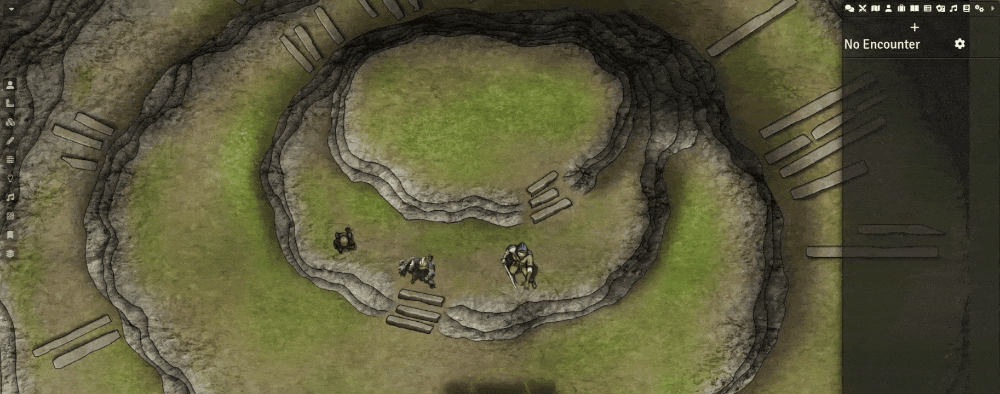
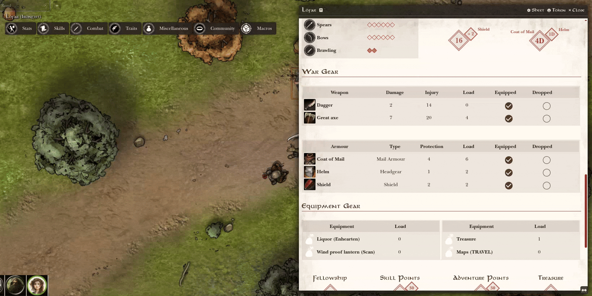

# Token Action HUD TOR2e

This module brings frequently used actions for The One Ring 2nd Edition into a movable Foundry HUD. Select a character, adversary, NPC, lore, or Community token to see the actions available for that actor.

## User guide

Read the [user guide](docs/user-guide.md) or download the [PDF manual](docs/token-action-hud-tor2e-manual.pdf).

## Features

- Roll skills, proficiencies, attacks, Protection, Valour, and Wisdom through TOR2E.
- Use right-click menus or Shift+F10 to manage equipment, edit permitted ranks, share items, and work with active effects.
- See key resources and conditions in the HUD header and open their fields on the native sheet.
- Check the company roster, roll assigned travel roles, play songs, open journey logs, and recover Hope through TOR2E.
- As Loremaster, manage combat, engagements, journey events, and bulk conditions. Choose which player controls and resource totals to share.
- Open available macros and use HUD Core to customize the toolbar's layout.

# Required Modules

## Token Action HUD Core
Token Action HUD TOR2e requires the [Token Action HUD Core](https://foundryvtt.com/packages/token-action-hud-core) module.

## socketlib
Token Action HUD Core requires the [socketlib](https://foundryvtt.com/packages/socketlib) library module.

# Recommended Modules
Token Action HUD uses the [Color Picker](https://foundryvtt.com/packages/color-picker) library module for its color picker settings.

# Support

For a guide on using Token Action HUD, go to: [How to Use Token Action HUD](https://github.com/Larkinabout/fvtt-token-action-hud-core/wiki/How-to-Use-Token-Action-HUD)

For questions, feature requests or bug reports, please open an issue [here](https://github.com/tdakanalis/token-action-hud-tor2e/issues).
